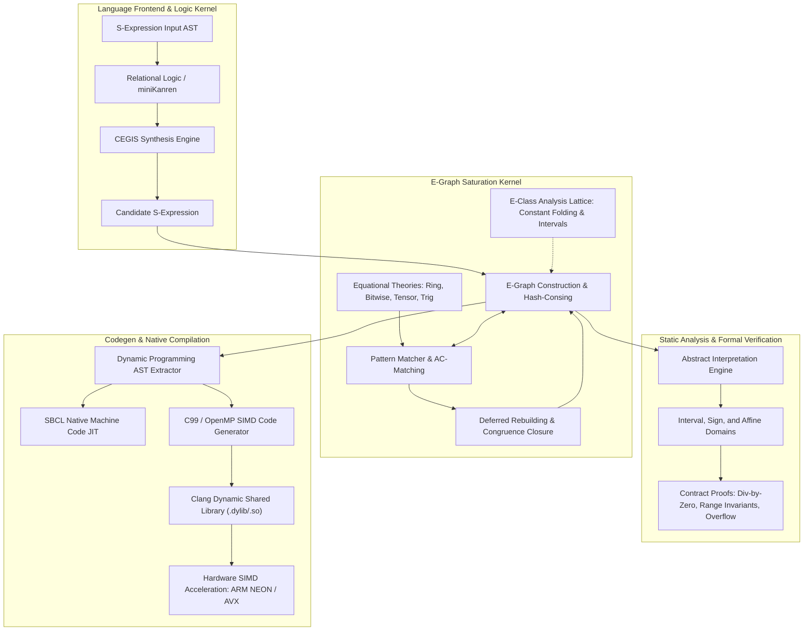

# Athanor System Architecture

Athanor is a high-performance equality saturation superoptimizer, relational synthesis kernel, abstract interpretation verifier, and differentiable S-expression abstract machine implemented in Common Lisp with native SIMD acceleration in C.

## 1. High-Level Subsystem Topology

Athanor couples declarative equational rewriting with relational inductive logic programming and static contract verification. Unlike traditional compilers that apply rewrite rules greedily (destroying intermediate representation structures and suffering from phase ordering pathologies), Athanor maintains an equivalence graph (E-Graph) of exponentially many equivalent programs simultaneously, extracting optimal expressions under precise hardware cost models.

## 2. Core Subsystems

### 2.1 E-Graph Kernel and Congruence Closure Engine
The heart of Athanor is a fast, lock-free equivalence graph representation built from three primary components:
1. **Disjoint-Set Forest (Union-Find)**: Implements two-pass path compression and union-by-rank balancing to maintain equivalence classes of term identifiers with near-constant amortized time complexity ($O(\alpha(N))$).
2. **Hash-Consing Table**: Deduplicates structural nodes (`enode`) across the entire system. An e-node consists of an operator symbol and a simple array of child equivalence class identifiers (`e-id`).
3. **Deferred Congruence Closure (Rebuilding)**: When equivalence classes are merged during rewrite rule application, parent invariant congruence is temporarily broken. Rather than rebuilding eagerly after every atomic merge (which costs quadratic time in naive implementations), Athanor records affected classes in an upward worklist and restores canonical congruence closure in batch iterations using `egraph-rebuild`.

### 2.2 Equational Rewrite Engine & AC-Matching
Athanor evaluates declarative rewrite rules of the form `LHS ~> RHS` with optional guard predicates.
- **Pattern Matcher**: Backtracking structural matcher handling wildcards, pattern variables (`?x`), and non-linear patterns where identical variables must belong to identical equivalence classes.
- **Associative-Commutative (AC) Matching**: Solves permutation and grouping symmetries for multi-arity algebraic operators like `+` and `*`, preventing combinatorial explosion by maintaining canonical normal forms.
- **Bounded Matching**: Employs per-rule match limits to prevent rewrite divergence in non-terminating bidirectional theories.

### 2.3 Equational Domain Theories
Athanor bundles multiple complete equational theories:
- **Ring Theory**: Commutative ring axioms over addition and multiplication, including zero annihilation, identity elimination, sign cancellation, and factoring.
- **Bitwise Superoptimizer**: Hacker's Delight twiddle laws, shift composition, bitwise involution cancellation, and strength reduction converting expensive integer multiplications into fast arithmetic shifts (`ash`).
- **Trigonometric Theory**: Pythagorean trigonometric identities, angle addition, double-angle expansions, and tangent-secant reductions.
- **Tensor Calculus & BLAS Fusion**: Matrix multiplication associativity, transposition involutions, trace cyclicity, and kernel fusion converting separate matrix multiply-adds into unified Level 3 BLAS `gemm` calls.
- **Floating-Point Stability**: Minimization of catastrophic cancellation using difference-of-squares factoring, small-argument transcendentals (`log1p`, `expm1`), and rationalization.

### 2.4 Relational Logic Programming (miniKanren, CLP(FD), Datalog)
Athanor embeds a pure relational logic programming kernel based on miniKanren:
- **Relational Unification**: First-order Robinson unification with sound occurs checks.
- **Non-Deterministic Streams**: Interleaving stream monads (`mplus`, `bind`) implementing complete breadth-first goal exploration.
- **CLP(FD)**: Finite domain constraint solver implementing AC-3 interval pruning, all-different constraints, and linear sum constraints.
- **Stratified Datalog Engine**: Deductive database evaluating Horn clauses with semi-naive fixpoint evaluation and negation-as-failure.

### 2.5 Component-Based Program Synthesis (CEGIS)
The synthesis engine derives verifiable programs from specifications:
- **Context-Free Grammar (CFG)**: Configurable production rules for arithmetic, logical, and domain-specific operators.
- **Observational Equivalence (OE)**: Prunes functionally identical partial candidate programs by evaluating them against concrete input vectors, compressing search trees by orders of magnitude.
- **Counterexample-Guided Inductive Synthesis (CEGIS)**: Closed-loop synthesis pipeline querying formal verification oracles. Candidate programs that fail verification generate counterexamples that refine the inductive specification in subsequent rounds.

### 2.6 Abstract Interpretation & Static Contract Verifier
Based on the Cousot & Cousot abstract interpretation framework, Athanor proves correctness properties statically without runtime overhead:
- **Interval Domain**: Sound bounding of expressions over real intervals with rigorous treatment of infinities and division bounds.
- **Sign Domain**: Three-valued sign lattice (`+`, `-`, `0`, `top`, `bottom`) for fast branch pruning.
- **Safety Proofs**: Automated static proofs establishing freedom from division by zero, provable containment in target output ranges (e.g., probability intervals $[0.0, 1.0]$), and integer overflow prevention in bounded hardware registers (e.g., 16-bit, 32-bit, 64-bit integer widths).

### 2.7 Automatic Differentiation & Fused Gradients
Athanor supports dual-mode automatic differentiation:
- **Forward-Mode AD**: Dual numbers with exact infinitesimal tracking for simultaneous evaluation of functions and directional derivatives.
- **Source-to-Source Reverse AD**: Analytical symbolic differentiation generating exact gradient vectors, Jacobians, and Hessians.
- **Fused Gradient Superoptimization**: Pipes symbolic gradient computation graphs into the equality saturation kernel, eliminating redundant expressions and fusing multi-layer linear operations.

### 2.8 Code Generation & Hardware Acceleration
Optimized expressions are emitted directly into native targets:
- **SBCL Machine Code JIT**: Directly compiles S-expressions into native x86-64 / ARM64 machine code functions with type declarations and unboxed scalar arithmetic.
- **C99 / OpenMP SIMD Emitter**: Emits clean C infix functions and vectorized batch loops annotated with `#pragma omp simd`.
- **CFFI Clang Bridge**: Compiles generated C code on-the-fly into dynamic shared libraries (`.dylib` or `.so`) and executes them via foreign function bindings.
- **Native SIMD Library**: Hand-optimized C kernel providing 128-bit ARM NEON vector instructions and unrolled memory streams delivering multi-gigabyte memory throughput.

## 3. Algorithmic Complexity

| Subsystem | Core Operation | Theoretical Complexity | Empirical Performance |
| :--- | :--- | :--- | :--- |
| Union-Find | `uf-find`, `uf-union` | $O(\alpha(N))$ amortized | < 15 ns per operation |
| E-Graph | Node deduplication | $O(1)$ average hash-cons | 2.1M nodes / sec |
| Rebuild | Congruence closure | $O(N \log N)$ worst-case | < 0.5 ms per iteration |
| AC-Matching | Term normalization | $O(K \log K)$ sorting | < 5 microseconds |
| Synthesis | Bottom-up enumeration | $O(B^D / \|OE\|)$ | Level 3 explored in < 2 ms |
| Abstract Eval | Interval bounds check | $O(\|AST\|)$ linear tree walk | < 20 microseconds |
| SIMD Engine | Vector dot product | $O(N / 4)$ vector loop | 5.5+ GFLOPS, > 50 GB/s |
