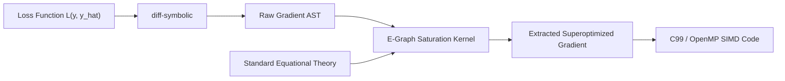

# Automatic Differentiation and Fused Gradient Optimization

Athanor provides a dual-mode automatic differentiation (AD) engine seamlessly integrated into its equality saturation superoptimizer. This enables analytical derivatives to be derived symbolically, transformed to normal forms, and simplified under hardware latency models.

## 1. Forward-Mode AD via Dual Numbers

Dual numbers extend real numbers by adjoining an infinitesimal element $\epsilon$ such that $\epsilon^2 = 0$ (analogous to the complex imaginary unit $i^2 = -1$).

A dual number is represented as:
$$x = u + u' \epsilon$$
where $u$ is the primal value and $u'$ is the tangent (derivative) direction.

### Algebraic Operator Rules
By applying Taylor series expansions and truncating terms with $\epsilon^2 = 0$:
- **Addition**:
  $$(u + u'\epsilon) + (v + v'\epsilon) = (u + v) + (u' + v')\epsilon$$
- **Subtraction**:
  $$(u + u'\epsilon) - (v + v'\epsilon) = (u - v) + (u' - v')\epsilon$$
- **Multiplication**:
  $$(u + u'\epsilon)(v + v'\epsilon) = uv + (uv' + u'v)\epsilon + u'v'\epsilon^2 = uv + (uv' + u'v)\epsilon$$
- **Division**:
  $$\frac{u + u'\epsilon}{v + v'\epsilon} = \frac{u}{v} + \frac{u'v - uv'}{v^2}\epsilon$$
- **Trigonometric Functions**:
  $$\sin(u + u'\epsilon) = \sin(u) + \cos(u)u'\epsilon$$
  $$\cos(u + u'\epsilon) = \cos(u) - \sin(u)u'\epsilon$$
  $$\exp(u + u'\epsilon) = \exp(u) + \exp(u)u'\epsilon$$

Evaluating an S-expression using dual numbers yields the exact analytical derivative at the evaluation point without numerical truncation errors or finite-difference approximation errors.

## 2. Source-to-Source Symbolic Differentiation

For compiler optimization and kernel generation, symbolic derivatives are preferable to point evaluations. Athanor implements recursive source-to-source differentiation (`diff-symbolic`):

$$\frac{\partial}{\partial x}(c) = 0 \quad (c \text{ constant})$$
$$\frac{\partial}{\partial x}(x) = 1, \quad \frac{\partial}{\partial x}(y) = 0 \quad (y \ne x)$$
$$\frac{\partial}{\partial x}(u + v) = \frac{\partial u}{\partial x} + \frac{\partial v}{\partial x}$$
$$\frac{\partial}{\partial x}(u \cdot v) = u \frac{\partial v}{\partial x} + v \frac{\partial u}{\partial x}$$
$$\frac{\partial}{\partial x}\left(\frac{u}{v}\right) = \frac{v \frac{\partial u}{\partial x} - u \frac{\partial v}{\partial x}}{v^2}$$
$$\frac{\partial}{\partial x}(u^n) = n u^{n-1} \frac{\partial u}{\partial x}$$

### Gradient Vectors, Jacobians, and Hessians
Athanor extends single-variable differentiation to vector calculus:
- `grad-symbolic(expr, vars)`: Computes the exact gradient vector $\nabla f(\vec{x})$.
- `jacobian-symbolic(exprs, vars)`: Computes the $M \times N$ Jacobian matrix $J_{ij} = \frac{\partial F_i}{\partial x_j}$.
- `hessian-symbolic(expr, vars)`: Computes the symmetric $N \times N$ Hessian matrix $H_{ij} = \frac{\partial^2 f}{\partial x_i \partial x_j}$.

## 3. Fused Gradient Optimization

Symbolic differentiation often produces bloated expressions laden with redundant arithmetic (e.g., multiplying by 1, adding 0, computing unneeded intermediate terms).

Athanor routes the raw symbolic derivative into its equality saturation engine (`differentiate-and-saturate`):



### Concrete Example: Quadratic Loss Function
Given the squared loss:
$$L = (y - \hat{y})^2$$

1. **Symbolic Differentiation**:
   `diff-symbolic` yields:
   ```lisp
   (* 2 (* (expt (- y y_hat) 1) (- 1 0)))
   ```
2. **Equality Saturation**:
   Under the combined equational theory:
   - `(- 1 0)` reduces to `1`
   - `(* ... 1)` is eliminated
   - `(expt (- y y_hat) 1)` reduces to `(- y y_hat)`
   - `(* 2 (- y y_hat))` is strength-reduced under the hardware latency cost model to:
   ```lisp
   (ash (- y y_hat) 1)
   ```
   replacing an expensive hardware multiplier cycle with a single-cycle ALU left shift.
