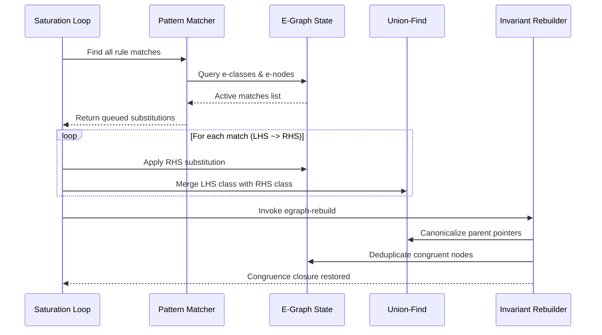

# Equality Saturation and E-Graph Kernel

Equality saturation is a program optimization technique that circumvents the destructive nature of traditional term rewriting. In classical compilers, applying an optimization rewrite rule (such as replacing $x \times 2$ with $x \ll 1$) permanently discards the original expression. If a later optimization pass requires the original multiplication structure to enable loop vectorization or constant factoring, the opportunity is permanently lost (the phase ordering problem).

Athanor solves this by evaluating all rewrites simultaneously into a compact data structure called an Equivalence Graph (E-Graph).

## 1. Mathematical Formalism

An E-Graph $\mathcal{G} = (\mathcal{C}, \mathcal{U}, \mathcal{H})$ consists of:
1. A set of equivalence classes $\mathcal{C} = \{c_1, c_2, \dots, c_m\}$.
2. A disjoint-set union-find partition $\mathcal{U}$ mapping each element $i \in \mathbb{N}$ to its canonical root class identifier $\text{find}(i) \in \mathcal{C}$.
3. A hash-consing map $\mathcal{H}: \text{ENode} \to \mathcal{C}$ mapping canonical equivalence nodes to equivalence classes.

An **equivalence node** (e-node) $n = f(c_1, c_2, \dots, c_k)$ represents an operator or terminal $f$ whose arguments are equivalence class identifiers $c_i \in \mathcal{C}$ rather than raw AST terms.

An **equivalence class** (e-class) $c = \{n_1, n_2, \dots, n_p\}$ represents a set of e-nodes that are provably equivalent under the equational theory.

### Congruence Invariant
The fundamental invariant of an E-Graph is congruence closure:
$$\forall f, \quad \left( \bigwedge_{i=1}^k c_i \equiv c'_i \right) \implies f(c_1, \dots, c_k) \equiv f(c'_1, \dots, c'_k)$$
If two e-nodes have identical operators and pairwise equivalent children, their containing equivalence classes must be merged.

## 2. Deferred Rebuilding Architecture

In traditional congruence closure algorithms (such as Nelson-Oppen or Downey-Sethi-Tarjan), restoring congruence closure eagerly after every individual union operation incurs high overhead.

Athanor adopts the deferred rebuilding strategy pioneered by Willsey et al.:
1. **Read-Only Matching Phase**: Rewrite rules match against the e-graph in its current canonical state, queuing required equality unions in a match list.
2. **Batch Union Phase**: Queued unions are enacted in the disjoint-set structure, recording modified classes into an upward repair worklist.
3. **Rebuilding Phase (`egraph-rebuild`)**: The worklist is drained. For each modified class:
   - Canonical child pointers of all referencing parent e-nodes are updated.
   - Hash-consing tables are refreshed.
   - Congruent parent e-nodes are detected and their classes merged recursively until a fixed point is reached.

## 3. E-Class Analyses and Lattices

An E-Class Analysis decorates every equivalence class with domain-specific metadata drawn from a semi-lattice $(L, \sqcup, \top, \bot)$.

The protocol defines three core generic operations:
- `analysis-make(analysis, enode, egraph)`: Compute initial lattice element for a newly allocated e-node based on operator semantics and child class data.
- `analysis-join(analysis, data1, data2)`: Join operator $\sqcup$ merging analysis data when two equivalence classes are unified.
- `analysis-modify(analysis, eclass, egraph)`: Analysis hook that may perform semantic constant propagation, class mergers, or trigger conditional rewrites.

### Constant Folding Analysis
Athanor implements compile-time arithmetic constant propagation as a first-class analysis pass:
- If all arguments to an arithmetic operator e-node are known constants, `analysis-make` evaluates the operation immediately in Common Lisp.
- `analysis-modify` injects the evaluated literal node into the equivalence class, guaranteeing that constant folding occurs monotonically without requiring separate AST traversal passes.

## 4. AST Extraction Under Cost Models

Once the e-graph has reached saturation (no new equivalence unions discovered) or hit iteration/node limits, an optimal concrete AST is extracted using dynamic programming:

$$\text{Cost}(c) = \min_{n \in c} \left( \text{NodeCost}(n) + \sum_{c_i \in \text{children}(n)} \text{Cost}(c_i) \right)$$

Athanor provides four standard cost models:
1. `:ast-size`: Minimizes total syntactic node count (favoring compact mathematical terms).
2. `:ast-depth`: Minimizes AST tree depth (maximizing parallel evaluation opportunities).
3. `:latency`: Minimizes hardware execution latency in CPU clock cycles based on elementary operator execution profiles (shifts = 1 cycle, multiply = 3 cycles, divide = 15 cycles, transcendentals = 30 cycles, tensor matmul = 100 cycles, fused BLAS GEMM = 50 cycles).
4. `:gpu-fused`: Penalizes memory roundtrips between un-fused array kernels, favoring composite BLAS and fused elementwise operations.
