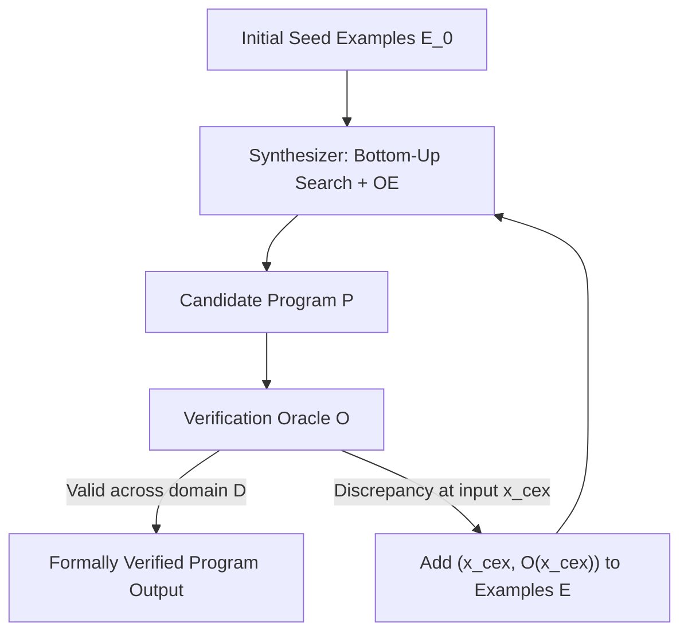

# Inductive Program Synthesis and CEGIS

Program synthesis is the task of automatically discovering an executable computer program that satisfies a given behavioral specification. Athanor combines component-based bottom-up enumerative synthesis with Counterexample-Guided Inductive Synthesis (CEGIS) to construct verified, optimal S-expression programs.

## 1. Problem Formulation

Given:
1. A **Context-Free Grammar** $\mathcal{G} = (\mathcal{V}, \Sigma, \mathcal{R}, \mathcal{S})$ defining the space of syntactically valid S-expressions.
2. A **Specification** $\Phi$, either as a finite set of input-output examples:
   $$\mathcal{E} = \{ (\vec{x}_1, y_1), (\vec{x}_2, y_2), \dots, (\vec{x}_k, y_k) \}$$
   or a semantic verification oracle function $\mathcal{O}: \mathcal{D} \to \mathcal{Y}$.

The objective is to synthesize a minimal program $P \in \mathcal{L}(\mathcal{G})$ such that:
$$\forall (\vec{x}, y) \in \mathcal{E}, \quad \llbracket P \rrbracket(\vec{x}) = y$$
and under CEGIS, establishing that $P$ is formally correct across the entire input domain $\mathcal{D}$:
$$\forall \vec{x} \in \mathcal{D}, \quad \llbracket P \rrbracket(\vec{x}) = \mathcal{O}(\vec{x})$$

## 2. Component-Based Bottom-Up Enumeration

A naive syntax tree enumeration generates programs in order of size, suffering from exponential state space explosion:
$$|\text{Programs of depth } d| = O\left( |\Sigma|^{k^d} \right)$$
where $k$ is the maximum operator arity.

Athanor structures the search bottom-up:
1. **Level 1 (Leaves)**: Terminals are instantiated, consisting of input parameter variables and constant integer literals.
2. **Level $d$ (Combinations)**: For each production rule $f(T_1, \dots, T_k)$, new terms are formed by taking the Cartesian product of sub-terms from lower levels:
   $$\text{Terms}_d = \bigcup_{f \in \mathcal{R}} f(\text{Terms}_{<d}, \dots, \text{Terms}_{<d})$$

## 3. Observational Equivalence (OE) Pruning

The critical algorithmic optimization in Athanor is **Observational Equivalence** (OE). Two syntactic expressions $P_1$ and $P_2$ may differ structurally (e.g., `(+ x 0)` versus `x`, or `(* a 2)` versus `(ash a 1)`), but exhibit identical evaluation behavior on the training input vectors:
$$\llbracket P_1 \rrbracket(\vec{X}) = \llbracket P_2 \rrbracket(\vec{X}) \iff \bigwedge_{j=1}^k \llbracket P_1 \rrbracket(\vec{x}_j) = \llbracket P_2 \rrbracket(\vec{x}_j)$$

The observational equivalence table `oe-table` maintains a signature hash map:
$$\text{Signature}(P) = \langle \llbracket P \rrbracket(\vec{x}_1), \dots, \llbracket P \rrbracket(\vec{x}_k) \rangle$$

- When an enumerated term $P$ yields a signature already recorded in `oe-table`, $P$ is redundant and pruned immediately.
- Only semantically novel expressions are retained in the term bank for subsequent combination rounds.
- This reduces the combinatorial branching factor by over 95% in typical arithmetic domains.

## 4. Counterexample-Guided Inductive Synthesis (CEGIS)

The CEGIS loop coordinates inductive synthesis with formal verification:

### Protocol Execution
1. The synthesis engine begins with a minimal seed set (typically 2 sample points).
2. The bottom-up enumerator finds a candidate program satisfying all current examples in under 5 milliseconds.
3. The verification oracle tests the candidate across its full parameter grid.
4. On the first encountered divergence, the counterexample input and its expected reference output are added to the example set.
5. The loop repeats until the candidate passes all domain tests or search depth limits are exhausted.

### Post-Synthesis Superoptimization
Once a candidate program is synthesized and verified by CEGIS, it is fed directly into Athanor's equality saturation kernel. The superoptimizer applies strength reduction (e.g., transforming synthesized multiplications into hardware-optimal ALU shifts) and emits vectorized native C code.
